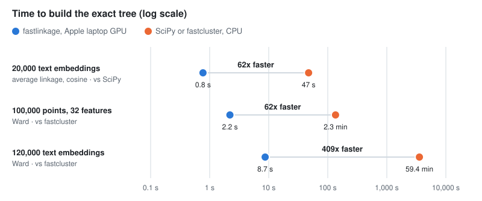
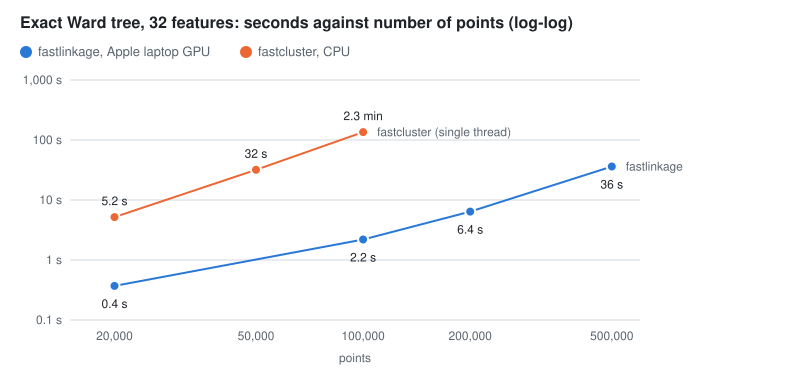

# fastlinkage

Exact hierarchical clustering on the GPU, without the n x n distance matrix.

It returns the same tree as `scipy.cluster.hierarchy.linkage` for Ward and
average linkage, runs in seconds at 100,000+ points, and uses memory that
grows with the number of points, not its square.

<picture>
  <source media="(prefers-color-scheme: dark)" srcset="assets/speed-dark.svg">
  
</picture>

> **Status: research prototype.** Tested on an Apple laptop GPU (PyTorch MPS)
> and on the CPU. Not yet tested on CUDA. Not on PyPI yet.

## Why

SciPy and scikit-learn build the full distance matrix. At 120,000 points that
is 58 GB, so most people give up on hierarchical clustering long before that
and switch to k-means or HDBSCAN. This package keeps the exact tree and drops
the matrix:

| | SciPy / scikit-learn | fastlinkage |
|---|---|---|
| Memory | n x n distances | one mean vector per cluster |
| 20,000 text embeddings (384 features), average cosine | 47 s | 0.8 s |
| 120,000 text embeddings, average cosine | needs a 58 GB matrix | 6.9 s |
| Result | exact | exact, same tree |

## Install

```
pip install git+https://github.com/michael-L-i/fastlinkage
```

Needs Python 3.10+, NumPy, SciPy and PyTorch. It uses CUDA or Apple MPS when
PyTorch sees one, and the CPU otherwise.

## Use

Drop-in for SciPy's `linkage`:

```python
from fastlinkage import linkage

Z = linkage(X, method="ward")                 # scipy: linkage(X, "ward")
Z = linkage(X, method="average_cosine")       # scipy: linkage(X, "average", metric="cosine")
Z = linkage(X, method="average_sqeuclidean")  # scipy: linkage(X, "average", metric="sqeuclidean")
```

`Z` is SciPy's linkage matrix, so everything downstream keeps working:

```python
from scipy.cluster.hierarchy import dendrogram, fcluster

labels = fcluster(Z, t=50, criterion="maxclust")
dendrogram(Z, truncate_mode="lastp", p=40)
```

Cluster embeddings without choosing the number of clusters:

```python
from fastlinkage import AgglomerativeClustering

model = AgglomerativeClustering(
    n_clusters=None, distance_threshold=0.35, linkage="average", metric="cosine"
).fit(embeddings)

model.labels_       # cluster of every row
model.n_clusters_   # how many clusters the threshold gave
```

The class follows scikit-learn's `AgglomerativeClustering` (`labels_`,
`children_`, `distances_`, `fit_predict`). Cutting one tree at several levels
costs almost nothing:

```python
from fastlinkage import cut, linkage

Z = linkage(embeddings, method="average_cosine")
coarse = cut(Z, n_clusters=20)
fine = cut(Z, distance_threshold=0.25)
```

A runnable version is in [`examples/quickstart.py`](examples/quickstart.py).

## Benchmarks

Measured on an Apple laptop GPU (PyTorch MPS, 18 CPU cores for the baselines).
Every timing builds the full tree.

| Data | Points | Linkage | fastlinkage | Baseline |
|---|---|---|---|---|
| Text embeddings, 384 features | 20,000 | Average, cosine | 0.8 s | SciPy 47 s |
| Text embeddings, 384 features | 20,000 | Ward | 1.0 s | SciPy 16 s |
| Text embeddings, 384 features | 120,000 | Average, cosine | 6.9 s | SciPy needs 58 GB |
| Text embeddings, 384 features | 120,000 | Ward | 8.7 s | fastcluster 59 min |
| Synthetic, 32 features | 100,000 | Ward | 2.2 s | fastcluster 135 s |
| Synthetic, 32 features | 200,000 | all three | 5.9 to 6.4 s | not run |
| Synthetic, 32 features | 500,000 | Average, cosine | 33 s | not run |
| Synthetic, 32 features | 500,000 | Ward | 36 s | not run |

- The text embeddings are AG News titles and descriptions, embedded with
  all-MiniLM-L6-v2.
- fastcluster's `linkage_vector` is the standard exact Ward that avoids the
  matrix. It is single-threaded.
- The same code on the CPU is 2x to 4x slower than on this GPU, so most of
  the gap to SciPy comes from the method, not the hardware.

<picture>
  <source media="(prefers-color-scheme: dark)" srcset="assets/scaling-dark.svg">
  
</picture>

Time grows with the square of the number of points. About a million points is
the practical limit.

## Exactness

The tree is checked against independent implementations:

| Check | Result |
|---|---|
| SciPy, 5,000 and 20,000 points, all three linkages, synthetic and real embeddings | merge heights equal to 1e-12; flat clusterings identical |
| fastcluster Ward, 100,000 synthetic points | heights equal to 5e-13 |
| fastcluster Ward, 120,000 text embeddings | heights equal to 1.4e-14 |
| Duplicated rows, near-duplicates (1e-7 noise), data offset by 1e4 | equal to SciPy to 1e-13 |

This takes some care. The GPU search runs in float32, and a plain float32
search picks a slightly wrong neighbour often enough to change the tree: an
earlier version of this code was off by up to 1.6 in merge height (tallest
merge 82) on the 120,000 embeddings. The current version accepts a float32
result only when it wins by more than the possible rounding error, and
otherwise compares the close contenders in float64.

With exact ties between different pairs (an integer grid, for example) the
tree is not unique, and this package and SciPy can return different valid
trees.

## How it works

Three known ideas and two additions.

1. **Cluster summaries instead of a matrix.** For these linkages the distance
   between two clusters follows from each cluster's size, mean vector and one
   scalar:

   | Linkage | Distance between clusters A and B |
   |---|---|
   | Ward | sqrt(2 \|A\|\|B\| / (\|A\|+\|B\|)) x \|\|mean(A) - mean(B)\|\| |
   | Average, cosine | 1 - mean(A) . mean(B), rows scaled to unit length |
   | Average, squared Euclidean | \|\|mean(A) - mean(B)\|\|^2 + var(A) + var(B) |

2. **Merge in rounds.** Every pair of clusters that are each other's nearest
   neighbour merges in the same round. For these linkages that gives exactly
   the tree of the one-merge-at-a-time algorithm. A full run takes 50 to 180
   rounds.

3. **Nearest-neighbour search as one matrix product** on the GPU.

4. **Neighbour lists that survive merges.** A search returns 16 candidates and
   a radius beyond which nothing else can be. When a cluster's neighbour is
   merged away, the next one usually comes from that list with no new search,
   and a merged cluster inherits its parents' lists. This halves the search
   work (from about 3 n^2 to 1.5 n^2 pair evaluations).

5. **A float32 rounding check** with a float64 fallback, described above.

[`docs/NOTES.md`](docs/NOTES.md) has the development notes: what was tried,
what was dropped, and the numbers for each step.

## Related work

None of the underlying algorithm is new, and this package does not claim it.

| Idea | Where it comes from |
|---|---|
| Merging reciprocal nearest neighbours in rounds | Murtagh (1980s); [ParChain](https://arxiv.org/abs/2106.04727) (2021, CPU); [RAC](https://arxiv.org/abs/2105.11653) (2021) |
| Average linkage from means and variances in linear memory | ParChain (CPU, kd-trees, low dimensions); [arXiv 1404.3439](https://arxiv.org/abs/1404.3439) |
| Exact Ward on the GPU | [cuhc](https://pypi.org/project/cuhc/) (2026, CUDA) |

What I could not find elsewhere is a GPU implementation of exact average
linkage (cosine or squared Euclidean) that avoids the distance matrix and
works on high-dimensional embeddings. cuhc keeps the matrix for average
linkage; ParChain's version is CPU-only and built for low dimensions. The
search was not exhaustive, so treat "first" as unconfirmed. I have also not
checked whether the neighbour-list rule (item 4) is published.

## Limits

- Three linkages only: Ward, average with cosine, average with squared
  Euclidean. Complete linkage and average linkage with plain Euclidean
  distance have no per-cluster summary and are not supported.
- Time is quadratic in the number of points.
- A float32 copy of every cluster mean lives on the GPU: 8 n d bytes (3 GB
  for a million points with 384 features).
- When distances are below float32 resolution (cosine distance between
  almost parallel vectors), the float64 fallback does most of the work and is
  slow. A warning is raised.
- Not tested on CUDA yet, and not compared with cuhc on the same hardware.

## Reproduce

```
git clone https://github.com/michael-L-i/fastlinkage && cd fastlinkage
pip install -e ".[test,bench]"
pytest                                        # exactness tests, CPU only
python experiments/exp1_correctness.py        # against scipy
python experiments/make_embeddings.py         # AG News embeddings (176 MB)
python experiments/exp6_cache.py              # 20k to 120k, both versions
python experiments/exp7_large.py              # fastcluster check, 200k, 500k
python experiments/make_charts.py             # the charts above
```

Raw numbers are in [`results/`](results).

## License

MIT
